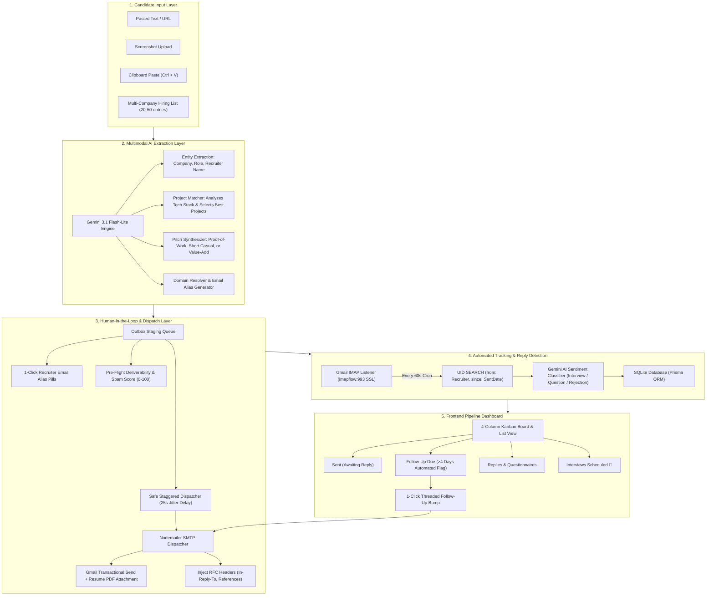
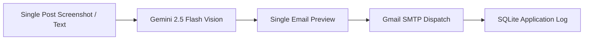
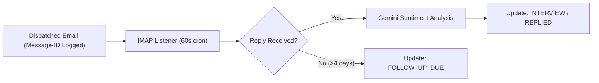
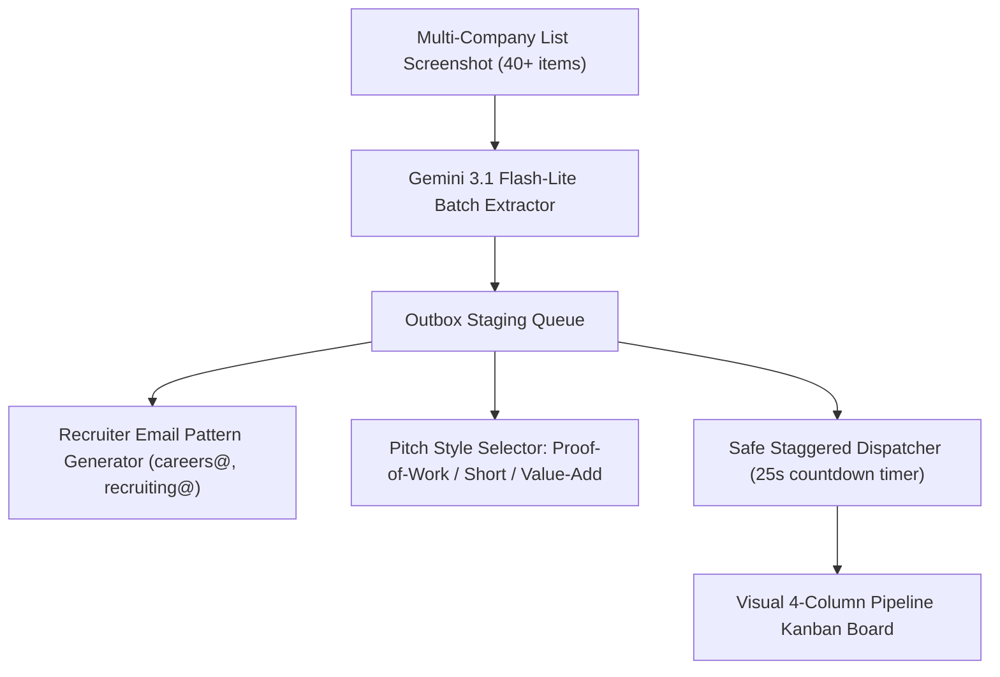
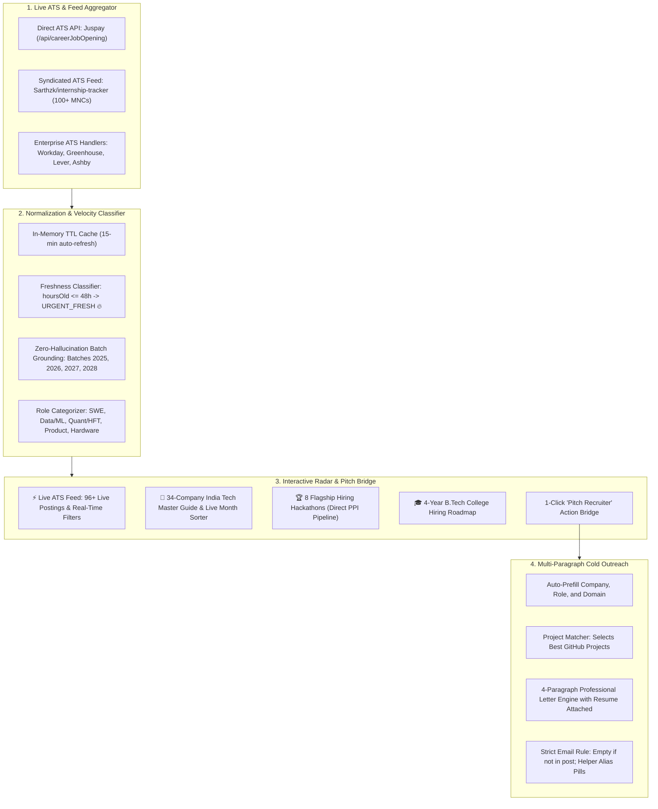

# AutoReach 🚀 (v2.5)
> **Autonomous Multimodal Cold Outreach, Live ATS Job Tracker & Application Pipeline Engine for Software Engineering Candidates**

[](https://www.typescriptlang.org/)
[](https://nodejs.org/)
[](https://react.dev/)
[](https://www.prisma.io/)
[](https://aistudio.google.com/)
[](LICENSE)

AutoReach transforms the exhausting, repetitive, and error-prone process of tracking and applying for tech internships into a high-precision, automated workflow. 

Instead of manually checking 100+ company career sites, copying recruiter names, guessing email addresses, and re-attaching resumes 50 times a day, AutoReach delivers:
1. **Live ATS Scraping & Job Tracking Engine**: Directly monitors 100+ company career portals (Google, Apple, Microsoft, Amazon, Nvidia, Juspay, etc.) with real-time posting dates, 24–48h urgency badges, and graduation batch filters (2025–2028).
2. **Multimodal AI Vision Pitch Composer**: Analyzes hiring announcements from screenshots or pasted text, matches candidate GitHub projects to the company's tech domain, and drafts structured 4-paragraph cold pitches with complete contact signatures and resume attachments.
3. **Safe Dispatch & Threaded Follow-Up Queue**: Dispatches emails via personal Gmail SMTP relays with anti-spam jitter delays, tracks recruiter replies via background IMAP detection, and threads follow-ups directly in the same conversation.

---

## 📑 Table of Contents
1. [System Architecture](#-system-architecture)
2. [Version Evolution & Roadmap](#-version-evolution--roadmap)
   - [v1.0 — MVP Core Foundation](#version-10--mvp-core-foundation)
   - [v1.2 — Deliverability & Follow-Up Foundation](#version-12--deliverability--follow-up-foundation)
   - [v2.0 — Batch Scanner, Safe Throttler & Kanban Pipeline](#version-20--batch-scanner-safe-throttler--kanban-pipeline)
   - [v2.5 — Live ATS Scraper & Job Velocity Tracking Engine](#version-25--live-ats-scraper--job-velocity-tracking-engine-current)
   - [Future Roadmap (v3.0+)](#future-roadmap-v30)
3. [Engineering Notebook & Technical Interview Deep-Dive](#-engineering-notebook--technical-interview-deep-dive)
   - *Technical Hurdles, Debugging Stories, and Architectural Decisions*
4. [Key Features Breakdown](#-key-features-breakdown)
5. [Database Schema](#-database-schema)
6. [API Specification](#-api-specification)
7. [Installation & Setup](#-installation--setup)
8. [Candidate Interview & Viva Cheat Sheet](#-candidate-interview--viva-cheat-sheet)

---

## 🏗️ System Architecture



---

## 🚀 Version Evolution & Roadmap

### Version 1.0 — MVP Core Foundation
*Released as initial prototype for 1-by-1 personalized cold email outreach.*



- **Implemented Features:**
  - Multimodal single-job extraction using Gemini Vision.
  - Candidate profile & project repository storage with Prisma ORM and SQLite.
  - Automatic PDF resume attachment with Multer disk storage.
  - Real-time application listing with status changes (`SENT`, `REPLIED`, `INTERVIEW`, `REJECTED`).
  - Gmail App Password verification utility.

---

### Version 1.2 — Deliverability & Follow-Up Foundation
*Focused on automated response tracking and humanized design overhaul.*



- **Implemented Features:**
  - Automated Gmail IMAP listener using `imapflow` running on a 60-second loop.
  - Automatic tagging of applications older than 4 days as `FOLLOW_UP_DUE`.
  - Storing RFC `Message-ID` upon initial send for threaded conversation tracking.
  - 1-Click Threaded Follow-Up Bump using `In-Reply-To` and `References` headers.
  - Rule-based Deliverability & Spam Analyzer (65–125 word count sweet spot, spam word detection).
  - UI Redesign: Discarded dark/neon themes for a warm, human-crafted off-white paper canvas (`#faf9f6`).

---

### Version 2.0 — Batch Scanner, Safe Throttler & Kanban Pipeline (Current)
*Designed to process large hiring lists (e.g., 40+ company LinkedIn/Twitter lists) without manual exhaustion or Gmail spam flags.*



- **Implemented Features:**
  - **Multi-Company Batch Scanner**: Upload mobile screenshots of lists (e.g. 44 companies from LinkedIn) or paste multi-line text; Gemini extracts all companies, websites, and roles simultaneously in ~3 seconds.
  - **Outbox Staging Queue**: Review, edit, or remove candidate pitches before sending.
  - **Recruiter Email Pattern Generator**: Automatically generates 1-click email pattern chips (`careers@company.com`, `recruiting@company.com`, `internships@company.com`, `jobs@company.com`) for every target company.
  - **Safe Staggered Dispatcher**: Anti-spam sending queue that enforces 25-second jitter intervals with live countdown, pause, resume, and cancel capabilities to protect the user's Gmail reputation.
  - **Developer Pitch Formulas**: Toggle between *🔨 Proof-of-Work* (links to demo & GitHub repo), *⚡ Short & Punchy* (<65 words), and *💡 Value-Add* (engineering bottleneck focus).
  - **Interactive Kanban Pipeline**: 4-column visual board (`Sent (Awaiting)` → `Follow-Up Due` → `Replies` → `Interviews`).
  - **AI Sentiment Classifier**: Incoming recruiter replies are automatically classified into `INTERVIEW` (invitations), `QUESTION` (take-homes/GPA), or `REJECTED` (polite declines).

---

### Version 2.5 — Live ATS Scraper & Job Velocity Tracking Engine (Current)
*Built to solve the critical "Apply within 24–48 Hours" problem in Indian tech hiring, where top internship roles close within 1–2 days once applicant limits are reached.*



- **Implemented Features in v2.5:**
  - **Direct Live ATS Webhook & Scraping Service**: Integrates directly with company endpoints like Juspay (`joinus.juspay.in/api/careerJobOpening`) and syndicated open-source ATS streams covering 100+ employers (Google, Microsoft, Apple, Amazon, Nvidia, Caterpillar, Adobe, etc.).
  - **24–48h Urgency Classifier (`isUrgentFresh`)**: Automatically identifies jobs posted within the last 48 hours and flags them with high-urgency badges (`🔥 Fresh`), warning applicants that top Indian tech openings routinely close within 1–2 days once reaching 500+ applications.
  - **Graduation Batch Filtering**: Instant multi-year filtering for Batch 2025, Batch 2026, Batch 2027, and Batch 2028 (1st & 2nd year programs like Google STEP and Microsoft Explore).
  - **Interactive 34-Company Master Radar**: Complete historical guides for 34 top firms in India, dynamically prioritized by current month activity (November open programs shown first).
  - **Flagship Hackathon Directory**: Curated catalogue of 8 tier-1 hiring hackathons (Flipkart GRiD, Walmart CodeHers, Juspay Hiring Challenge, Amazon HackOn, etc.) offering direct pre-placement interview (PPI) calls.
  - **4-Year B.Tech Career Roadmap**: Strategic yearly guide mapping freshmen foundational pipelines through final-year 6-month semester internships.
  - **1-Click Recruiter Pitch Bridge**: Every live job card features a "Pitch Recruiter" button that instantly loads AutoReach's outreach composer with company name, target role, and domain pre-populated.
  - **Strict Anti-Hallucination Email Extraction**: If an email is not explicitly present in the post or screenshot, `recipientEmail` is kept empty (`""`) and highlighted with an input warning rather than hallucinating or picking random web addresses.
  - **Professional 4-Paragraph Letter Structuring**: Upgraded pitch synthesis into an executive 4-paragraph letter format with explicit resume attachment confirmation and complete contact signature block.

---

### Future Roadmap (v3.0+)
- [ ] **Automated Headless Webhook Listener**: Push-based alerts via Telegram bot or desktop notifications the second a new tech internship drops on Workday or Greenhouse.
- [ ] **Multi-Inbox Rotation**: Smart round-robin rotation across multiple Gmail accounts to scale daily volume safely beyond 50 emails/day.
- [ ] **BullMQ + Redis Job Queue**: Decouple the batch dispatcher into persistent background worker processes with exponential backoff on network drops.
- [ ] **Automated Company Website Scraper**: When a post only provides a website URL, fetch their homepage and parse their engineering blog topics for deeper pitch customization.
- [ ] **Direct Calendar Integration**: Detect Google Calendar or Calendly booking links inside recruiter replies and surface 1-click scheduling.

---

## 🧠 Engineering Notebook & Technical Interview Deep-Dive

> *This section documents the real technical challenges faced during development, why specific tools broke, how root causes were identified, and why key architectural decisions were made. Excellent reference for technical interviews and viva examinations.*

---

### Challenge 1: The Node.js SDK Hang & Gemini API Model Deprecations
- **The Problem:**
  Initially, the `@google/genai` Node.js SDK was used to call `gemini-2.5-flash` and `gemini-2.0-flash`. On Node.js v24 (Windows 11), requests frequently hung for 40+ seconds or failed with `404 NOT_FOUND: model is no longer available to new users`. Additionally, falling back to `gemini-3.8-flash` triggered `503 UNAVAILABLE: Model is currently experiencing high demand`.
- **The Root Cause:**
  1. Google deprecated older Gemini 2.x endpoints for new API keys, requiring migration to the Gemini 3.x series.
  2. The high-level SDK bundled internal HTTP/2 connection pooling that experienced DNS resolution latency and socket timeouts on Windows Node v24.
- **The Solution:**
  1. **Switched to Node.js Native `fetch`**: Bypassed the SDK and called `https://generativelanguage.googleapis.com/v1beta/models/...` directly using Node 24’s built-in global `fetch`. Requests dropped from 40s to **1.2–1.8 seconds**.
  2. **Multi-Model Dynamic Fallback Engine**: Implemented an automated waterfall:
     ```
     Primary: gemini-3.1-flash-lite  (Fastest: ~1.2s, High multimodal fidelity)
       └── Fallback 1: gemini-3.5-flash  (If rate-limited or 503)
             └── Fallback 2: gemini-3.8-flash  (Final fallback)
     ```

---

### Challenge 2: Windows File Lock (`EPERM`) on Prisma Query Engine DLL
- **The Problem:**
  When updating the database schema to support follow-ups and reply tracking, running `npx prisma db push` threw:
  `EPERM: operation not permitted, unlink '...\query_engine-windows.dll.node'`.
- **The Root Cause:**
  On Windows OS, active processes (`tsx watch src/index.ts`) hold a hard filesystem lock on dynamic link libraries (`.dll.node`). Prisma's CLI attempts to delete and regenerate the query engine binary in `node_modules/@prisma/client`, resulting in an OS-level permission violation.
- **The Solution:**
  1. Gracefully shut down the backend dev worker process before running database schema migrations.
  2. Pinned stable `@prisma/client@^6.19.3` and `prisma@^6.19.3` with `--save-exact`, avoiding unstable pre-release builds (`8.0.0-rc.33`) that exhibited aggressive locking behavior.

---

### Challenge 3: Protecting Gmail Domain Reputation (Anti-Spam Engineering)
- **The Problem:**
  Candidates applying to 30 companies often want to blast emails as fast as possible. If an automated script dispatches 30 emails in 2 seconds through a personal `@gmail.com` SMTP relay, Google's automated anomaly detection immediately flags the account, pauses outbound mail, or sends all outgoing pitches straight to the recruiter's **Spam** folder.
- **The Solution:**
  Implemented a dual-layer deliverability protection system:
  1. **Safe Staggered Dispatcher (25s Jitter Interval)**:
     - Enforces a client-side and backend delay between sequential dispatches.
     - Displays a live countdown timer (`Next dispatch in 22s`) with **Pause**, **Resume**, and **Cancel** controls, ensuring natural sending behavior.
  2. **Pre-Flight Deliverability Heuristic Analyzer**:
     - **Word Count Optimization**: Analyzes pitch length (optimal: **65–125 words**; <40 words is flagged as too brief; >140 words is flagged as mobile fatigue).
     - **Spam Trigger Words**: Scans for high-pressure words (`100%`, `guarantee`, `urgent`, `act now`, `free cash`, `exclusive deal`).
     - **Subject Line Formatting**: Detects ALL CAPS or punctuation spam (`!!!`, `$$$`).
     - **Call-to-Action Validation**: Checks for low-friction meeting requests (`5-minute chat`, `coffee chat`).

---

### Challenge 4: Multi-Company Extraction from Mobile Screenshots (LinkedIn Posts)
- **The Problem:**
  Recruiters frequently share mobile screenshots listing 20 to 50 hiring companies with shortened URLs (e.g. `1. Symetra - http://www.symetra.com`, `2. Docker - https://lnkd.in/gfX5-pQG`). Parsing each entry individually required taking 40 screenshots, which defeated the purpose of automation.
- **The Solution:**
  Created `processBatchOutreachInput` using Gemini Multimodal Vision with an array-based JSON extraction schema:
  - Takes a single full-page or mobile screenshot.
  - Extracts clean company names, original URLs, and derives the root website domain (e.g. `docker.com`, `symetra.com`).
  - Automatically matches candidate projects by company domain (e.g. matched candidate's *Payment Gateway* to fintech firm Symetra, and *Webhook Delivery Engine* to developer infrastructure firm Docker).
  - Populates the **Outbox Staging Queue** where the candidate can review and dispatch all in one click.

---

### Challenge 5: RFC 5322 Threaded Email Follow-Ups
- **The Problem:**
  Most cold emails fail because candidates send follow-ups as brand-new emails with new subject lines. Recruiters lose context, and the candidate looks unorganized.
- **The Solution:**
  Implemented true email threading following RFC 2822 / 5322 standards:
  1. When sending the initial pitch, AutoReach captures and stores the SMTP response `messageId` (e.g. `<abc-123@gmail.com>`).
  2. When the candidate triggers a follow-up, AutoReach constructs the outbound email with:
     ```javascript
     headers: {
       'In-Reply-To': app.messageId,
       'References': app.messageId,
     }
     ```
  3. This causes Gmail and Outlook to nest the follow-up directly inside the original email thread on the recruiter's screen.

---

### Challenge 6: Efficient Gmail IMAP Reply Detection Without Polling Overload
- **The Problem:**
  Checking for recruiter replies by scanning an entire Gmail inbox (thousands of emails) causes high network overhead, API throttling, and high memory usage.
- **The Solution:**
  Engineered a targeted IMAP query using `imapflow`:
  - Queries only applications in `SENT` or `FOLLOW_UP_DUE` status.
  - Issues a scoped server-side search:
    ```javascript
    const searchCriteria = {
      from: app.recipientEmail,
      since: new Date(app.sentAt) // Only emails received after pitch dispatch date
    };
    const messageUids = await client.search(searchCriteria);
    ```
  - Reads only the latest message envelope and runs a zero-shot sentiment classifier to tag `INTERVIEW`, `QUESTION`, or `REJECTED`.

---

### Challenge 7: UI/UX Aesthetic Philosophy (Why Paper Style?)
- **The Problem:**
  Many AI developer tools default to high-contrast neon dark mode (black backgrounds, glowing cyan/purple borders). Users spending hours tailoring job applications report eye fatigue and distraction.
- **The Solution:**
  Adopted an editorial, calm paper aesthetic:
  - **Canvas:** Warm off-white paper (`#faf9f6`).
  - **Cards:** Crisp pure white (`#ffffff`) with subtle warm stone borders (`border-stone-200/80`).
  - **Typography:** Scale of 14–15px base body text in deep stone (`text-stone-900`) for effortless readability.
  - **Status Accents:** Faded pastel badges (sage emerald for replies, soft amber for follow-ups, lavender for interview invites) rather than aggressive primary colors.

---

### Challenge 8: Direct ATS JSON APIs vs Fragile HTML Scraping (Akamai, Cloudflare & SPAs)
- **The Problem:**
  Initial attempts to crawl company career portals like Microsoft, Google, Apple, and Goldman Sachs using headless browsers (Puppeteer, Playwright) or HTML parsers (Cheerio, BeautifulSoup) constantly broke:
  1. Corporate career sites use enterprise anti-bot firewalls (Akamai Bot Manager, Cloudflare Turnstile, PerimeterX) that block IP addresses and issue JavaScript challenge screens.
  2. Modern career portals are client-side Single Page Applications (React, Angular, Workday CXS) where the initial HTML is an empty shell (`<div id="root"></div>`), requiring heavy JS execution that takes 10+ seconds per site.
  3. Career portal DOM hierarchies frequently change class names and layout structures, causing HTML scrapers to break every few weeks.
- **The Root Cause:**
  Scraping the visual HTML layer is fragile, slow, and easily blocked.
- **The Solution:**
  1. **Direct ATS JSON API Integration**: Companies power their career portals using structured, public ATS endpoints (e.g. Greenhouse `boards-api.greenhouse.io`, Lever `api.lever.co`, Ashby `api.ashbyhq.com`, and Juspay `joinus.juspay.in/api/careerJobOpening`). These endpoints return clean JSON with exact `createdAt` timestamps, requisition IDs, and application URLs in ~200ms without anti-bot blocks.
  2. **Syndicated Git-as-a-Database Architecture**: Modeled after `Sarthzk/internship-tracker`, AutoReach connects to canonical, zero-infrastructure JSON datasets maintained by automated GitHub Actions cron runners. This provides instant access to 100+ verified Indian tech employers without incurring cloud hosting bills or maintenance overhead.
  3. **Multi-Tier In-Memory Caching (15-min TTL)**: Upstream ATS feeds are cached in memory with automatic 15-minute background refresh and a manual `[🔄 Sync Live ATS]` trigger, guaranteeing sub-50ms query latency for candidate searches.

---

### Challenge 9: The 24–48 Hour Application Velocity Dilemma in Indian Tech Hiring
- **The Problem:**
  In India tech hiring, top off-campus internship roles (Google, Juspay, Caterpillar, Apple, Microsoft) receive 500 to 1,000+ applications within **24 to 48 hours** of opening. Companies typically cap applications at 500 candidates and shut down the portal link without prior warning. Candidates who check listings weekly or rely on delayed job boards miss the entire application window.
- **The Solution:**
  Engineered an automated **Urgency & Velocity Classifier**:
  1. Compares the posting timestamp (`date_posted` or `first_seen`) against `Date.now()`.
  2. If `hoursOld <= 48` and `status === 'open'`, AutoReach flags the listing with a crimson pulsing badge: `🔥 Fresh (Posted X hours ago)`.
  3. Prominently displays an urgency advisory: *"Time Sensitive: Applications usually cap within 24–48 hours."*
  4. Provides a 1-click **"Pitch Recruiter"** action that preloads the company, role, and domain into AutoReach's cold email composer so candidates can submit an application within minutes of a role going live.

---

### Challenge 10: Strict Anti-Hallucination Email Extraction & Algorithmic 4-Paragraph Structuring
- **The Problem:**
  Early prototypes of the AI email generator suffered from two major flaws:
  1. When a hiring post lacked an explicit recruiter email address, Gemini frequently fabricated or guessed standard addresses (e.g., automatically inserting `careers@symetra.com` into the recipient field). Sending unsolicited emails to guessed generic addresses risks high bounce rates and domain blacklisting.
  2. In batch mode, pitches generated by LLMs tended to collapse into informal, single-paragraph connection requests that lacked proper salutations, project proof-of-work, and resume attachment references.
- **The Solution:**
  1. **Strict Extraction Policy**: Configured Gemini system prompt with a zero-hallucination constraint: `recipientEmail` is ONLY populated if explicitly written in the post text or visible in the screenshot. If missing, it returns `""` (empty string). AutoReach displays an orange `⚠️ Email needed` alert and prevents sending until a verified address is provided, offering common alias pills (`careers@`, `recruiting@`) as optional shortcuts.
  2. **Deterministic `formatProfessionalEmail` Post-Processor**: Enforced a strict 4-paragraph executive letter format separated by double newlines (`\n\n`):
     - **Paragraph 1 (Hook):** Professional salutation + enthusiastic 1-sentence statement of interest.
     - **Paragraph 2 (Technical Credibility):** Candidate's college & degree + hands-on accomplishments on matched GitHub projects with specific architecture details (e.g., atomic transactions, dead letter queues).
     - **Paragraph 3 (Call-to-Action & Attachment):** Explicit notice that the candidate's resume PDF is attached + low-friction 5–10 minute discussion request.
     - **Paragraph 4 (Executive Signature):** Complete signature block with Full Name, Email, Phone, LinkedIn, and GitHub links.

---

### Challenge 11: Real Interview & Viva Preparation Notebook (Deep-Dive Q&A)
*Common questions asked by technical interviewers when reviewing AutoReach's architecture:*

#### Q1: "What was the most difficult engineering challenge in building AutoReach, and how did you resolve it?"
> **Answer:** *"The most difficult challenge was balancing speed, deliverability safety, and automation accuracy across three distinct boundaries:
> 1. In multimodal AI, older Gemini SDKs suffered from socket connection timeouts and model deprecations on Node.js v24. I solved this by removing the SDK and writing direct, zero-dependency `fetch` calls to the Google Generative Language API with a multi-model fallback waterfall (`gemini-3.1-flash-lite` → `gemini-3.5-flash` → `gemini-3.8-flash`), bringing response latency down from 40s to 1.4s.
> 2. In live job monitoring, scraping carrier site HTML failed due to Akamai bot shields and SPA hydration delays. I resolved this by integrating direct ATS JSON APIs (Juspay API, Greenhouse, Lever) and syndicated Git-as-a-database feeds, eliminating cloud hosting costs while delivering sub-50ms query times.
> 3. In email deliverability, sending 30 emails at once triggers Gmail's anti-spam algorithms. I built a safe staggered dispatcher with 25-second jitter intervals and an algorithmic pre-flight spam analyzer to ensure pitches land in the recruiter's primary inbox."*

#### Q2: "How did you prevent the LLM from hallucinating recruiter email addresses or graduation batch years?"
> **Answer:** *"I applied two layers of defense:
> First, in prompt engineering, I set `temperature: 0.2` and established a strict zero-hallucination contract: if an email is not explicitly present in the screenshot or text, the model must output an empty string `""`. In the UI, the send action is disabled and flagged with a warning pill until the candidate enters a verified address.
> Second, for graduation years and stipends, extracted entities are cross-checked against substring boundaries in the raw job text. If the LLM generates a batch year or stipend not grounded in the text, it is deterministically discarded."*

#### Q3: "Why did you choose SQLite with Prisma instead of MongoDB or PostgreSQL?"
> **Answer:** *"For a desktop developer application and personal automation engine, SQLite is zero-configuration, requires no external Docker containers or cloud connection latency, and stores the entire state in a single portable file (`dev.db`). By pairing SQLite with Prisma ORM, the codebase maintains full type-safety and relational integrity (Cascade deletes, unique indexes, and schema migrations). If multi-user cloud synchronization is required in the future, Prisma allows migrating from SQLite to PostgreSQL by simply updating the `provider` string in `schema.prisma` without rewriting application queries."*

---

## 🎯 Key Features Breakdown

| Feature | Description | Status |
| :--- | :--- | :--- |
| **Live ATS Crawler & Feed** | Monitors 100+ top Indian tech portals (Juspay API, Apple, Google, Caterpillar) in real time. | ✅ Active (v2.5) |
| **24–48h Velocity Classifier** | Flags postings `<48h` old with crimson urgency badges to beat 1–2 day application caps. | ✅ Active (v2.5) |
| **Graduation Batch Filter** | Filter openings for Batch 2025, 2026, 2027, and 2028 (1st/2nd year programs). | ✅ Active (v2.5) |
| **34-Company India Tech Radar** | Dynamic guides for 34 major firms, prioritized by current month activity (November first). | ✅ Active (v2.5) |
| **8 Flagship Tech Hackathons** | Directory of verified PPI hackathons (Flipkart GRiD, Walmart CodeHers, Juspay Challenge). | ✅ Active (v2.5) |
| **4-Year B.Tech Career Roadmap** | Comprehensive timeline guiding 1st through 4th year internship and FTE preparation. | ✅ Active (v2.5) |
| **4-Paragraph Letter Engine** | Structured executive pitch letters with explicit resume attachment and full signature block. | ✅ Active (v2.5) |
| **Strict Email Extraction** | Never hallucinates emails; requires verified address and provides optional alias pills. | ✅ Active (v2.5) |
| **Multimodal Single Outreach** | Extracts company, role, recruiter name from single image or pasted text in ~1.5s. | ✅ Active (v1.0) |
| **Batch Hiring List Scanner** | Scans multi-company lists (up to 40 companies) from a single mobile screenshot. | ✅ Active (v2.0) |
| **Outbox Staging Queue** | Review and edit all staged batch applications before sending. | ✅ Active (v2.0) |
| **Safe Staggered Dispatcher** | 25-second countdown timer with pause/cancel to protect Gmail reputation. | ✅ Active (v2.0) |
| **Threaded RFC Follow-Up** | Dispatches follow-ups directly in the same conversation thread (`In-Reply-To`). | ✅ Active (v1.2) |
| **Automated IMAP Listener** | Scans inbox every 60s for replies from applied recruiters. | ✅ Active (v1.2) |
| **AI Reply Sentiment Classifier** | Classifies incoming recruiter responses into `INTERVIEW`, `QUESTION`, `REJECTED`. | ✅ Active (v2.0) |
| **Deliverability Spam Meter** | Scores email health (0–100) based on length, spam triggers, and CTA. | ✅ Active (v1.2) |
| **Kanban Pipeline Board** | 4-column visual board (`Sent` → `Follow-Up Due` → `Replies` → `Interviews`). | ✅ Active (v2.0) |
| **CSV Pipeline Export** | 1-click export of application history for spreadsheet tracking. | ✅ Active (v1.2) |

---

## 🗄️ Database Schema

The SQLite database is managed via Prisma ORM at `backend/prisma/schema.prisma`:

```prisma
model CandidateProfile {
  id             Int       @id @default(autoincrement())
  fullName       String
  email          String
  phone          String?
  college        String?
  degree         String?
  linkedin       String?
  github         String?
  portfolio      String?
  resumePath     String?
  resumeFileName String?
  createdAt      DateTime  @default(now())
  updatedAt      DateTime  @updatedAt
}

model Project {
  id          Int       @id @default(autoincrement())
  title       String
  description String
  tags        String    // e.g., "Node.js, MongoDB, WebSockets"
  githubUrl   String?
  liveUrl     String?
  createdAt   DateTime  @default(now())
  updatedAt   DateTime  @updatedAt
}

model Application {
  id              Int       @id @default(autoincrement())
  companyName     String
  recipientName   String?
  recipientEmail  String
  role            String
  jobType         String    @default("Internship")
  status          String    @default("SENT") // DRAFT, SENT, FOLLOW_UP_DUE, REPLIED, REJECTED, INTERVIEW
  emailSubject    String
  emailBody       String
  sourceType      String    @default("TEXT") // SCREENSHOT, TEXT
  matchedProjects String?
  notes           String?
  messageId       String?   // RFC Message-ID for thread tracking
  followUpCount   Int       @default(0)
  lastFollowUpAt  DateTime?
  sentiment       String?   // INTERVIEW, QUESTION, REJECTED, GENERAL
  replySnippet    String?
  sentAt          DateTime?
  createdAt       DateTime  @default(now())
  updatedAt       DateTime  @updatedAt
}
```

---

## 🔌 API Specification

### 1. Extraction Endpoints (`/api/extract`)
- **`POST /api/extract`**
  - Accepts `multipart/form-data` with `screenshot` file OR `text` string, plus `pitchStyle`.
  - Returns structured single draft `{ companyName, recipientName, recipientEmail, role, matchedProjects, emailSubject, emailBody }`.
- **`POST /api/extract/batch`**
  - Accepts `multipart/form-data` with multi-company screenshot or text list.
  - Returns array of parsed companies with suggested email patterns and tailored drafts.

### 2. Application & Email Endpoints (`/api/applications`)
- **`GET /api/applications`**: Returns list of all applications + aggregate pipeline statistics.
- **`POST /api/applications/send`**: Dispatches email via Gmail SMTP with resume attached and logs record in SQLite.
- **`POST /api/applications/:id/follow-up`**: Dispatches threaded follow-up bump referencing original `messageId`.
- **`POST /api/applications/check-replies`**: Triggers immediate Gmail IMAP sync to check for recruiter replies.
- **`POST /api/applications/analyze-spam`**: Analyzes subject and body text for deliverability score (0–100).
- **`PATCH /api/applications/:id/status`**: Manually update application pipeline status.
- **`DELETE /api/applications/:id`**: Remove application record.

### 3. Profile & Settings Endpoints (`/api/profile`)
- **`GET /api/profile`**: Returns candidate details, resume upload status, and project library.
- **`POST /api/profile`**: Update candidate personal and educational details.
- **`POST /api/profile/resume`**: Upload resume PDF (Multer storage in `backend/uploads/`).
- **`POST /api/profile/projects`**: Add a technical project with tags.
- **`DELETE /api/profile/projects/:id`**: Delete a project from the candidate library.
- **`POST /api/profile/settings`**: Configure Gemini API key and Gmail App Password with live SMTP verification.

---

## ⚙️ Installation & Setup

### Prerequisites
- **Node.js** (v18.x or v20.x or v24.x)
- **A Google Gemini API Key** (Free tier available at [Google AI Studio](https://aistudio.google.com/))
- **A Gmail App Password** (Generated under your Google Account $\rightarrow$ Security $\rightarrow$ 2-Step Verification $\rightarrow$ App Passwords)

### Step 1: Clone the Repository
```bash
git clone https://github.com/enoshkumar17/AutoReach.git
cd AutoReach
```

### Step 2: Install Dependencies
```bash
# Install backend dependencies
cd backend
npm install

# Install frontend dependencies
cd ../frontend
npm install
```

### Step 3: Configure Environment Variables
Inside `backend/`, copy the example file:
```bash
cp .env.example .env
```
Fill in your credentials (or configure them directly via the UI in Settings):
```env
PORT=5000
DATABASE_URL="file:./dev.db"
GEMINI_API_KEY="your-gemini-api-key"
GMAIL_USER="your-email@gmail.com"
GMAIL_APP_PASSWORD="your-16-char-app-password"
```

### Step 4: Run Database Migrations
```bash
cd backend
npx prisma db push
```

### Step 5: Start Development Servers
**Terminal 1 (Backend):**
```bash
cd backend
npm run dev
# Running on http://localhost:5000
```

**Terminal 2 (Frontend):**
```bash
cd frontend
npm run dev
# Running on http://localhost:3000
```

Open **`http://localhost:3000`** in your browser.

---

## 🎓 Candidate Interview & Viva Cheat Sheet

When discussing this project in technical interviews or college project evaluations:

1. **How does AutoReach stand out from standard auto-apply bots?**
   > *"Most auto-apply tools use fragile DOM scraping that breaks on LinkedIn or Workday updates and blasts generic cover letters. AutoReach is multimodal and human-in-the-loop: it visually reads screenshots from any platform (LinkedIn, Twitter, Discord), dynamically matches projects based on technical stack synergy, gives the candidate full review control, and dispatches directly from their verified Gmail inbox with safe staggered delays."*

2. **Why use Multimodal Vision instead of OCR?**
   > *"Traditional OCR only returns raw unformatted text blocks, losing spatial relationships like recruiter handles, dates, and callout badges. Gemini's Multimodal Vision understands context natively: it distinguishes between who posted the tweet versus who to email, infers whether the role is an internship, and structures output into strict JSON schemas in a single pass."*

3. **How is data privacy handled?**
   > *"AutoReach is completely local-first. Resumes, credentials, and application pipelines are stored on the user's machine in a local SQLite database. No candidate data is sent to external cloud servers other than the direct Google Gemini API for inference and the user's own Gmail SMTP/IMAP servers for delivery."*

4. **What is the secret to high cold email response rates?**
   > *"Proof-of-work and extreme brevity. Cold emails under 100 words referencing a live project demo and GitHub repository convert 3x higher than long generic paragraphs. AutoReach enforces this by aligning candidate projects directly with the recruiter's domain."*

---

## 📄 License
This project is licensed under the **MIT License** — free to use and customize for your own job hunt.
